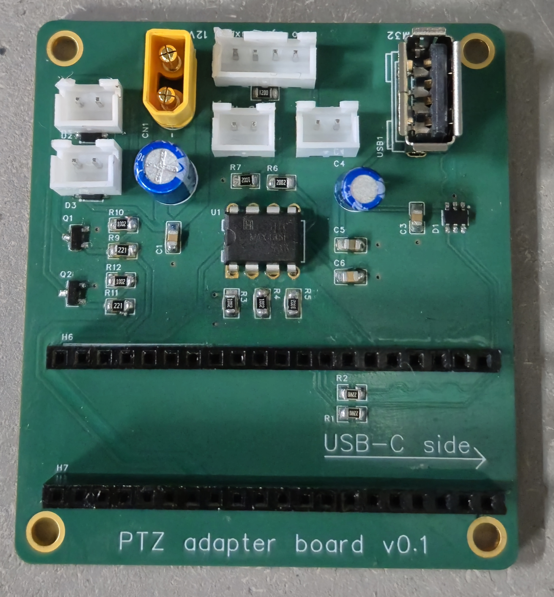
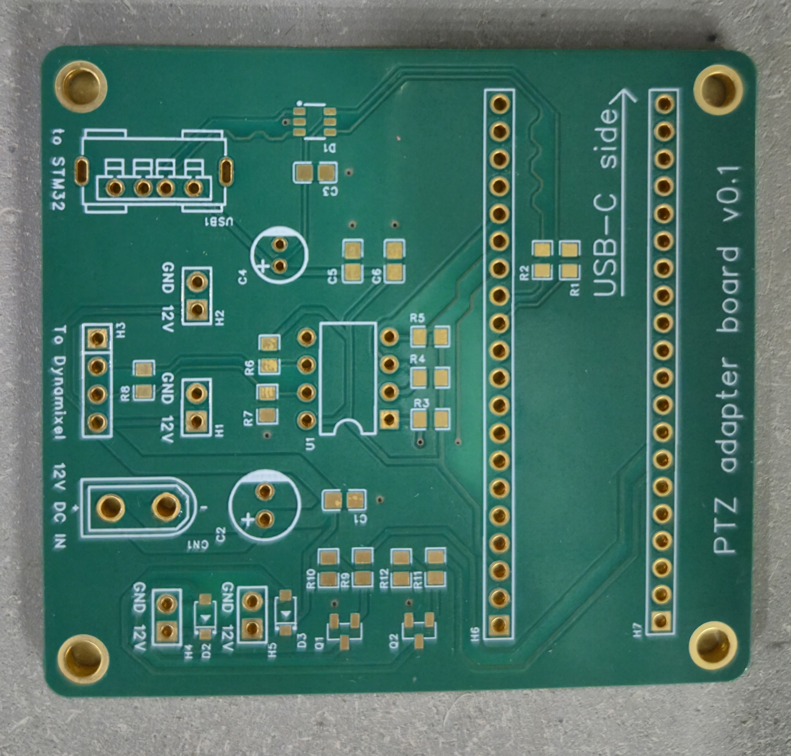
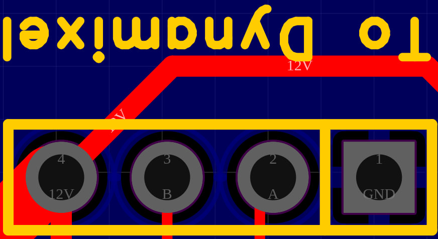

# Dynamixel RS-485 and load control adapter — v0.1

A general purpose adapter board for connecting **Dynamixel motors over RS-485** and switching two external loads, with firmware for the STM32F411CEU6. The firmware receives commands through USB CDC (a virtual serial port), forwards Dynamixel Protocol 1.0 packets through an RS-485 transceiver, and controls two load outputs.

**Motor interface: half-duplex RS-485. Use Dynamixel motors with an RS-485 interface; the TTL UART versions require a different electrical interface.** USART1 connects the STM32 to the onboard transceiver; the motor connection is RS-485.

This repository includes the schematic and PCB project, the STM32CubeIDE firmware project, and a [ready-to-flash HEX file](firmware/prebuilt/PTZ_X30.hex).

> **Correct the placement of H4/H5 and D2/D3 before manufacturing the board.** In v0.1, the connectors are too close to the diodes and cover the silkscreen. See the details and assembled board photo below.

## Photos

### Assembled board



### Bare PCB



## Repository structure

```text
.
├── README.md
├── LICENSE
├── .gitignore
├── hardware/
│   ├── dynamixel_adapter_v0.1.epro2  # EasyEDA Pro schematic and PCB
│   └── bom.csv                      # grouped bill of materials
├── firmware/
│   ├── .project / .cproject         # STM32CubeIDE project PTZ_X30
│   ├── PTZ_X30.ioc                 # STM32CubeMX configuration
│   ├── Core/                       # startup, GPIO, USART, and main code
│   ├── USB_DEVICE/                 # USB CDC and command handling
│   ├── Drivers/                    # STM32 HAL and CMSIS
│   ├── Middlewares/                # USB Device library
│   ├── prebuilt/PTZ_X30.hex         # prebuilt firmware
│   └── STM32F411CEUX_*.ld           # linker scripts
└── docs/
    └── images/                     # board v0.1 photos and H3 pinout
```

## Hardware

Source project: [hardware/dynamixel_adapter_v0.1.epro2](hardware/dynamixel_adapter_v0.1.epro2). The archive contains the schematic, PCB layout, and associated library elements. Its metadata records editor version `3.2.149.88089769`.

The board provides a power input marked **12 V DC IN**, a **Dynamixel RS-485 connection**, USB, two switched load outputs, and sockets for an STM32 module. Module orientation is marked **USB-C side**. Refer to the schematic for connector pinouts and component values.

### Connectors

| Connector | Purpose | Connections |
| --- | --- | --- |
| H1, H2 | Direct 12 V supply connections | 12 V and GND; not controlled by firmware |
| H3 | Connection to Dynamixel RS-485 motors | Pin 1: GND; pin 2: A; pin 3: B; pin 4: 12 V |
| H4, H5 | Software-controlled 12 V load outputs | Connect external loads here; controlled by the USB load commands described below |

**H3 pin order does not match the motor connector pin order.** Wire the cable by signal rather than by matching pin positions. The PCB screenshot below shows H3 with pins **4, 3, 2, 1 from left to right** in the displayed orientation; pin 1 has a square pad.



This image is a quick reference. Before connecting power or motors, open the [schematic project](hardware/dynamixel_adapter_v0.1.epro2) and check all connections against the motor pinout.

### Known board issues in v0.1

- **H4 and H5 are too close to D2 and D3.** The assembled board photo shows the connector housings immediately beside the diodes. When reproducing the board, move the connectors or diodes apart to accommodate the actual component bodies and allow room for soldering.
- **H4 and H5 cover the silkscreen**, including labels near the connectors. Move reference designators and pin labels outside the connector housings so they remain readable after assembly.

Apply these changes **before ordering a new batch of PCBs**. The published project retains the original v0.1 layout with these issues.

### Reproducing the board

1. Import the `.epro2` file into EasyEDA Pro and open the schematic and PCB.
2. Correct the placement of H4/H5, D2/D3, and the affected silkscreen.
3. Match footprints to the components you will use, and check connector, diode, and STM32 module orientation.
4. Run the design rule check (DRC), then export Gerber files, drill files, and a bill of materials (BOM).

Gerber files are not included in this repository.

### Bill of materials

[Download BOM (CSV)](hardware/bom.csv). The BOM is extracted from the component data embedded in the EasyEDA Pro project, with schematic attributes applied to the library defaults and PCB footprint overrides preserved. It covers 33 board components and groups matching parts by quantity. Voltage ratings are included where specified in the project. Supplier numbers are preserved from the project; an explicitly cleared supplier number is left blank.

Review the notes column before ordering:

- **R1, R2, R9, R10, R11, R12:** the library device is named `Res_0603`, but the PCB uses `R0805_NEW` footprints.
- **H6/H7:** the library specifies male headers, while the assembled board photo shows female sockets. Choose the connector gender required for the STM32 module.

The STM32 module itself is not included in this board BOM.

## Firmware

### Configuration

| Parameter | Value in the source code |
| --- | --- |
| Microcontroller | STM32F411CEU6 |
| External HSE crystal | 25 MHz |
| Core clock | 96 MHz |
| USB | USB OTG FS, CDC class |
| Motor interface | Half-duplex RS-485 |
| Motor protocol | Dynamixel Protocol 1.0 |
| USART1 to RS-485 transceiver | 1,000,000 baud, 8N1, no hardware flow control |
| USART1 TX / RX | PA9 / PA10 |
| RS-485 direction control | PA8: 1 = transmit, 0 = receive |
| Load control signals | PA1 and PA2; initial state = 0 |
| SWD | PA13 (SWDIO), PA14 (SWCLK) |

The main application logic is in [usbd_cdc_if.c](firmware/USB_DEVICE/App/usbd_cdc_if.c).

### USB commands

Send commands as **binary bytes**.

The host implements the Dynamixel communication protocol: it constructs complete instruction packets, including the motor ID, instruction, parameters, length, and checksum, and interprets motor responses. The microcontroller acts as a USB-to-RS-485 bridge and forwards the received command bytes unchanged to the motor bus.

Packets of at least four bytes starting with `FF FF` are forwarded through USART1 and the RS-485 transceiver. The firmware switches the transceiver between transmit and receive, waits for a Dynamixel Protocol 1.0 response, determines its size from the `LEN` field, and returns the response bytes unchanged over USB. The response buffer holds 256 bytes. This header and length handling frames the response; motor commands and response contents are handled by the host.

Four-byte commands control the two load outputs:

| Command bytes | Action |
| --- | --- |
| `AA AA 01 01` | Set PA1 high |
| `AA AA 01 00` | Set PA1 low |
| `AA AA 02 01` | Set PA2 high |
| `AA AA 02 00` | Set PA2 low |

Load commands do not return a USB acknowledgement. USART1 baud rate is fixed in the firmware; changing the virtual serial port baud rate does not change the motor bus baud rate.

### Building from source

The project was created in **STM32CubeIDE 1.10** and uses **STM32Cube FW_F4 V1.27.0**. HAL drivers, CMSIS, and USB middleware are included in the repository.

1. In STM32CubeIDE, select **File → Import → General → Existing Projects into Workspace**.
2. Select the `firmware/` directory and import the `PTZ_X30` project.
3. Choose the `Debug` or `Release` configuration and run **Build Project**.
4. For debugging with ST-LINK, use `PTZ_X30 Debug.launch` and check the SWD connection.

The `Debug/` and `Release/` directories are generated during builds and excluded by `.gitignore`. The `.project`, `.cproject`, `.ioc`, and linker script files are needed to open and build the project.

## License

Original firmware contributions, hardware design files, and documentation are licensed under the [MIT License](LICENSE). You may use, modify, reproduce, and distribute the project, including commercially, subject to the license terms.

Third-party components retain their own licenses:

- [CMSIS](firmware/Drivers/CMSIS/LICENSE.txt);
- [CMSIS Device STM32F4xx](firmware/Drivers/CMSIS/Device/ST/STM32F4xx/LICENSE.txt);
- [STM32F4xx HAL](firmware/Drivers/STM32F4xx_HAL_Driver/LICENSE.txt);
- [STM32 USB Device Library](firmware/Middlewares/ST/STM32_USB_Device_Library/LICENSE.txt).
